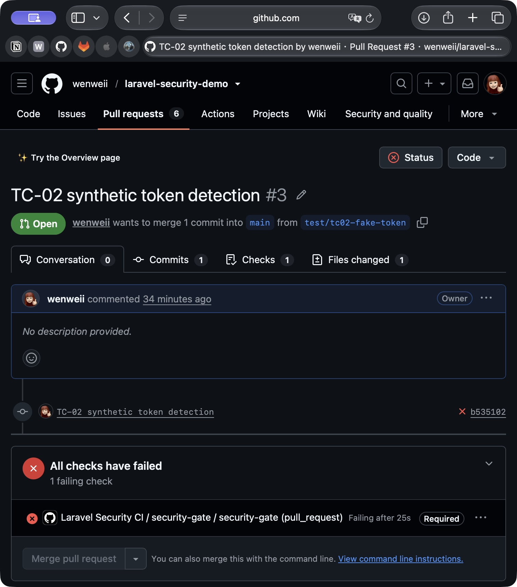
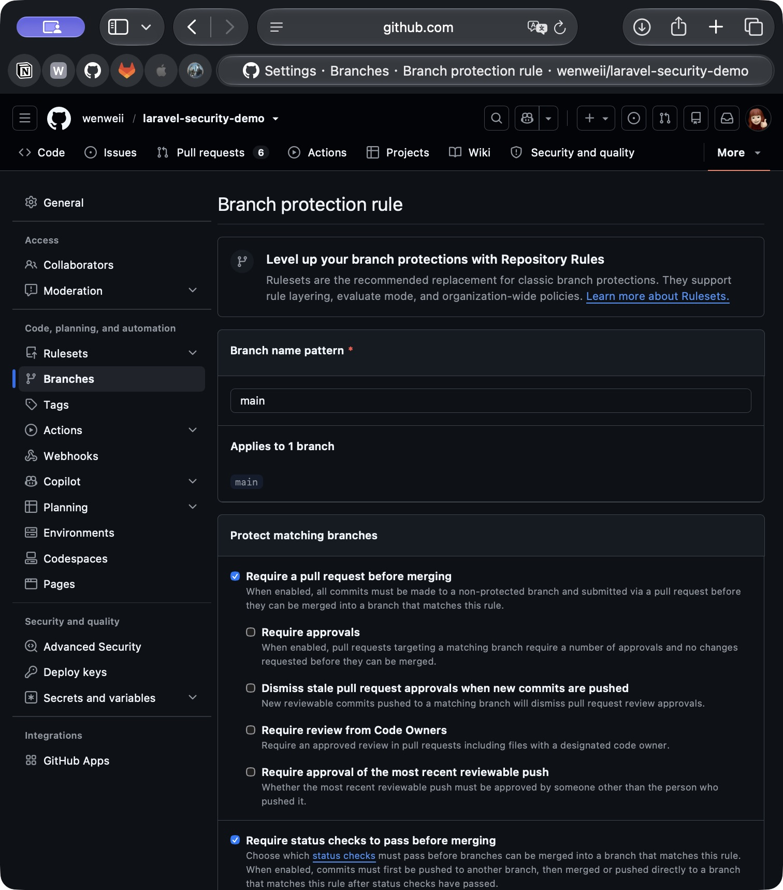
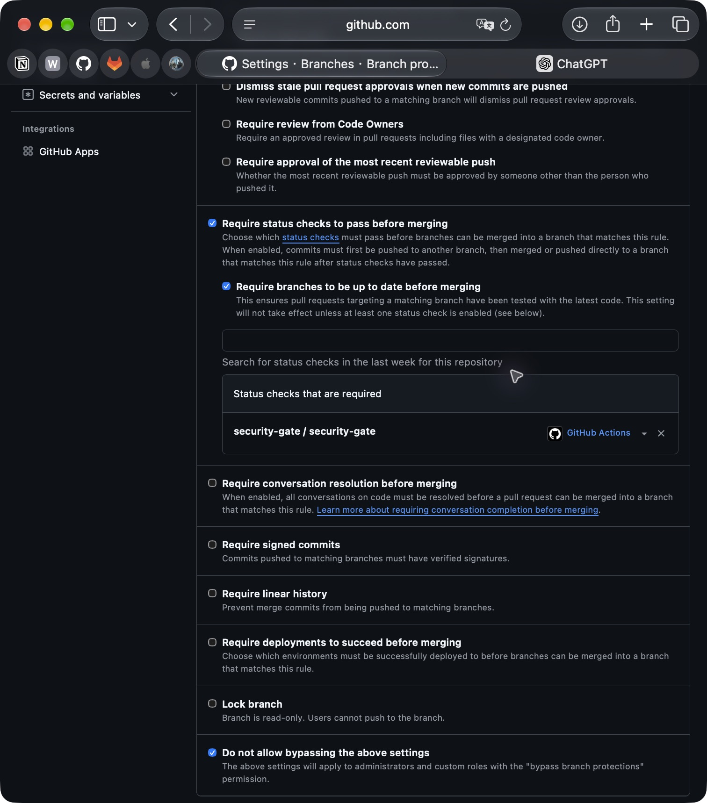
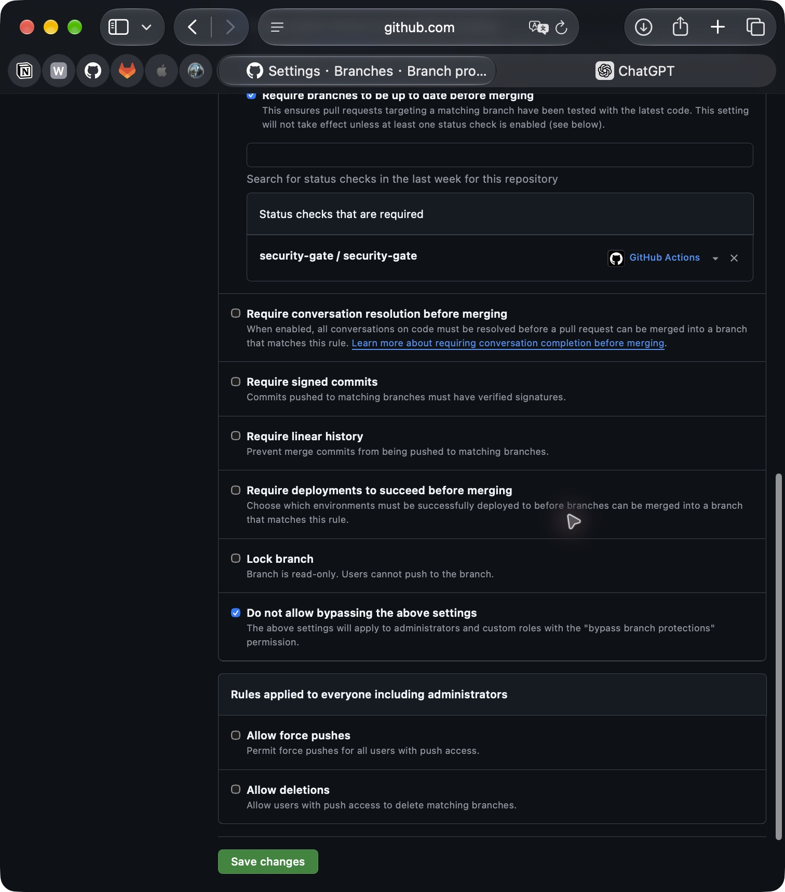

# Laravel Security CI 正式驗收紀錄

- 執行日期：2026-11-16（Asia/Taipei）
- 執行者：Codex；GitHub Owner：`wenweii`
- 中央 Repository：[wenweii/security-ci](https://github.com/wenweii/security-ci)
- 測試 Repository：[wenweii/laravel-security-demo](https://github.com/wenweii/laravel-security-demo)
- 兩者均為 Public，預設分支均為 `main`。
- 來源：已完整讀取提供的 14 頁 PDF 手冊與 18 個有效素材檔。Owner 已明確授權使用解壓後的 `security-ci` 內容，略過原始 ZIP 封裝核對。
- 本文件取代初始空白驗收範本；初次 Phase 0 受阻紀錄保留在本機 `PHASE0_BLOCKED_RECORD.md`，不代表目前狀態。

## 最終結論

**PASS：七項測試全部通過，且證據完整。**

此處 PASS 指各案例符合其預期；TC-02～TC-04 的預期是掃描真正偵測風險並使 Gate 失敗。TC-07 另以 Required Check、Branch API、PR 合併狀態與 GitHub 介面確認阻擋，並非從紅色 Run 推論。

證據原始資料、Check Run ID、PR API 結果及帶時間戳記的日誌摘錄保存於 [EVIDENCE.json](docs/security-ci-acceptance/EVIDENCE.json)。已補齊 TC-07 合併阻擋及已保存 Branch Protection 設定的 4 張原始實際截圖，見下方截圖證據補件。原有 API 與日誌證據完整保留。完整 Branch Protection 管理 API 的權限限制另列於文末。

## 七項驗收

| ID | 測試目的／期望 | 實際結果 | PR | Actions Run | 實際證據 | 截圖檔 | 日期 |
|---|---|---|---|---|---|---|---|
| TC-01 | 正常 PR 應通過 | PASS | [#1](https://github.com/wenweii/laravel-security-demo/pull/1) | [成功回歸](https://github.com/wenweii/laravel-security-demo/actions/runs/43842537226) | Composer、Gitleaks、Semgrep ERROR、Semgrep WARNING outcome 全為 success；Final Gate success | 未保存；使用 API／日誌 | 2026-11-16 |
| TC-02 | Gitleaks 阻擋合成 Token | PASS（Gate 預期 failure） | [#3](https://github.com/wenweii/laravel-security-demo/pull/3) | [Run](https://github.com/wenweii/laravel-security-demo/actions/runs/43843094351) | Working tree 與 PR history 各找到 1 筆；`tree=1, PR-history=1`；僅 Gitleaks outcome failure，Final Gate failure | 未保存；使用 API／日誌 | 2026-11-16 |
| TC-03 | Semgrep ERROR 阻擋 eval | PASS（Gate 預期 failure） | [#4](https://github.com/wenweii/laravel-security-demo/pull/4) | [Run](https://github.com/wenweii/laravel-security-demo/actions/runs/43843152699) | `app/semgrep_fail.php` 命中 `php-no-eval`，1 finding；ERROR outcome failure，其他掃描 success，Final Gate failure | 未保存；使用 API／日誌 | 2026-11-16 |
| TC-04 | Composer Audit 阻擋漏洞鎖定套件 | PASS（Gate 預期 failure） | [#5](https://github.com/wenweii/laravel-security-demo/pull/5) | [Run](https://github.com/wenweii/laravel-security-demo/actions/runs/43843253802) | symfony/http-foundation v5.4.0 找到 4 筆 Advisory，包含 CVE-2024-50345／PKSA-b35n-565h-rs4q；Audit outcome failure，Final Gate failure | 未保存；使用 API／日誌 | 2026-11-16 |
| TC-05 | 全新乾淨歷史 PR 恢復成功 | PASS | [#6](https://github.com/wenweii/laravel-security-demo/pull/6) | [Run](https://github.com/wenweii/laravel-security-demo/actions/runs/43843388898) | 四項掃描與 Final Gate success；比較 API 顯示從乾淨 main 領先 1 commit、僅新增 tc05-clean.txt；PR history 掃描 1 commit | 未保存；使用 API／日誌 | 2026-11-16 |
| TC-06 | 短版 Caller 跨 Repository 呼叫中央 CI | PASS | [#1](https://github.com/wenweii/laravel-security-demo/pull/1)、[#6](https://github.com/wenweii/laravel-security-demo/pull/6) | [TC-01](https://github.com/wenweii/laravel-security-demo/actions/runs/43842537226)、[TC-05](https://github.com/wenweii/laravel-security-demo/actions/runs/43843388898) | `referenced_workflows` 與 job log 都確認使用 wenweii/security-ci 的中央 Workflow；Composite Action、規則與腳本在中央執行 | 未保存；使用 API／日誌 | 2026-11-16 |
| TC-07 | 失敗 Required Check 確實阻擋合併 | PASS | [#3](https://github.com/wenweii/laravel-security-demo/pull/3) | [失敗 Required Check](https://github.com/wenweii/laravel-security-demo/actions/runs/43843094351/job/133216392510) | Required Check failure、main protected、PR API `mergeable_state=blocked`；GitHub 顯示 Required 且 Merge pull request 停用；未執行合併或 Bypass | [合併阻擋實際截圖](docs/security-ci-acceptance/screenshots/tc07-merge-blocked.jpg) | 2026-11-16 |

所有驗收 PR 均未合併，分支保留。TC-02 維持開啟，供 Owner 重現 TC-07。`mergeable=true` 僅代表沒有內容衝突，不能解讀為符合安全合併條件；同筆 PR API 的 `mergeable_state=blocked` 才是保護規則下的合併狀態。乾淨 TC-05 同時回傳 `mergeable_state=clean`，可供對照。

### Commit 與 Check Run

Workflow Name：`Laravel Security CI`；中央 Workflow Name：`Central Laravel Security CI`。實際 Check Run 名稱：`security-gate / security-gate`；來源 GitHub Actions，App ID `15368`。

| 案例 | Head Commit SHA | Check Run／Job ID |
|---|---|---|
| TC-01 成功回歸 | b6d9a8518b931e8c27c56de3f359e78c449ff725 | 133214516678 |
| TC-02 | b5351025a4c3d35c57842b209e48b813944f1166 | 133216392510 |
| TC-03 | 45d9702af0e87be1f7221761fc5b115f61d2810e | 133216589094 |
| TC-04 | fa3822918677de21d3dc5a1643e45af786fe3ee4 | 133216937407 |
| TC-05 | 171b5fa6f7340e57a88373a868d2fadc8e76fe5c | 133217387439 |

上述 Run 的中央 Workflow 與 Action 使用中央 commit `e7935fc22edafd7dc00d2aefa5c38f87a9fb6208`。測試 Repository 的乾淨 main 為 `90dd3d805bb48e668565dff89e020619b7084f74`。

## Branch Protection：實際保存後重新讀取

[已保存的 main 保護規則](https://github.com/wenweii/laravel-security-demo/settings/branch_protection_rules/86398652)；[Branch API](https://api.github.com/repos/wenweii/laravel-security-demo/branches/main)。

| 設定 | 實際狀態與驗證 |
|---|---|
| Branch name pattern | main；套用 1 個分支 |
| Require a pull request before merging | 已啟用；保存後重新開啟設定頁確認 |
| Require status checks to pass | 已啟用 |
| Required Check | security-gate / security-gate；由成功 TC-01 Check Run API 取得，未猜測名稱 |
| Check source | GitHub Actions，App ID 15368 |
| Require branches to be up to date | 已啟用 |
| Do not allow bypassing | 已啟用；Branch API 回傳 enforcement_level=everyone |
| Allow force pushes | 未啟用，即禁止 |
| Allow deletions | 未啟用，即禁止 |
| 額外 Reviewer approval | 未要求；保留 Require PR，無需以自我審查卡住單人練習 |

此為新建 Repository 的新規則，沒有刪除或降低既有保護。GitHub 頁面先回報 `Branch protection rule created.`，再重新開啟規則確認設定；Branch API 實際回傳 `protected=true`、`protection.enabled=true`、正確的 context 與 App ID。TC-07 的失敗 PR 當下仍開啟，且合併按鈕停用。

## 截圖證據補件（2026-11-16）

以下皆為直接從 GitHub 實際畫面擷取、未經合成或重畫的原始 JPEG。設定畫面是重新開啟已保存的既有規則，不是未儲存的新建表單；本次沒有修改或再次儲存保護設定。擷取期間只調整檢視比例與捲動位置，完成後恢復原比例。

| 截圖 | 可查證內容 | 來源頁面 |
|---|---|---|
| [TC-07 合併阻擋](docs/security-ci-acceptance/screenshots/tc07-merge-blocked.jpg) | PR #3 仍開啟，base main，Security Gate failure 且標示 Required，Merge pull request 按鈕停用 | [PR #3](https://github.com/wenweii/laravel-security-demo/pull/3) |
| [main 與 Require PR](docs/security-ci-acceptance/screenshots/branch-protection-main-pr.jpg) | Branch name pattern main，套用 main，Require a pull request before merging 已勾選 | [已保存規則](https://github.com/wenweii/laravel-security-demo/settings/branch_protection_rules/86398652) |
| [Required Check 與嚴格更新](docs/security-ci-acceptance/screenshots/branch-protection-required-check.jpg) | Require status checks、Require branches to be up to date 已勾選；實際 context security-gate / security-gate，來源 GitHub Actions | [已保存規則](https://github.com/wenweii/laravel-security-demo/settings/branch_protection_rules/86398652) |
| [管理者與破壞性操作限制](docs/security-ci-acceptance/screenshots/branch-protection-admin-restrictions.jpg) | Do not allow bypassing 已勾選，適用管理者；Allow force pushes、Allow deletions 均未勾選 | [已保存規則](https://github.com/wenweii/laravel-security-demo/settings/branch_protection_rules/86398652) |

### TC-07：失敗 Required Check 與停用合併按鈕

### Branch Protection：main 與 Require PR

### Branch Protection：Required Check 與更新要求

### Branch Protection：管理者不得繞過、禁止 Force Push 與刪除

## 掃描與 Gate 政策驗證

- Composer：保留 `composer audit --locked --abandoned=report --no-interaction`。實際查詢 locked 套件，TC-04 有 Advisory 並阻擋；abandoned 保持只回報。TC-01 初次執行錯誤也確實使 Gate 失敗，沒有被誤判為成功偵測。
- Gitleaks：保留中央 `gitleaks.toml`、`useDefault=true` 與合成 Token 規則 `security-ci-fake-test-token`。Run 環境確認載入中央 config。TC-02 的新增檔與原 Fixture 一致，工作目錄及 PR 歷史各偵測 1 筆；預設日誌只輸出數量，未宣稱日誌列出了 Rule ID。原腳本僅掃描目前目錄與 merge-base 到 HEAD 的 PR commits，不是整個 Repository 全歷史。
- Semgrep ERROR：三項原始規則與排除範圍未變；使用 `--severity ERROR --error --strict`。TC-03 實際 Rule ID 為 `home.runner.work._actions.wenweii.security-ci.main..github.actions.laravel-security.config.php-no-eval`，1 finding 並阻擋。
- Semgrep WARNING：兩項原始規則與排除範圍未變；使用 `--severity WARNING --strict`，沒有 `--error`。補充 [PR #7](https://github.com/wenweii/laravel-security-demo/pull/7)／[Run](https://github.com/wenweii/laravel-security-demo/actions/runs/43845174207) 命中 `unserialize()`，WARNING outcome success，Final Gate success。Semgrep 摘要雖將 finding 稱為 blocking，實際 exit outcome 與 Gate 成功證明本設定的 WARNING finding 為 advisory。此補充 PR 未執行 PHP、未合併。
- Final Gate：保留 `if: always()`，檢查四項 scanner step 的 `outcome`，而非被 `continue-on-error` 改寫後的 `conclusion`。TC-02～TC-04 掃描 finding 的 step 結果為 outcome=failure／conclusion=success，Final Gate 仍正確 failure。四項 outcome 全為 success 的 TC-01、TC-05 及 WARNING 補充測試，Gate 才成功。WARNING 掃描器若 outcome 為 failure、skipped 或 missing，原條件也會阻擋；本次未額外注入 WARNING 工具故障。

實際工具安裝成功：PHP 8.3、Composer 2.11.2、Python 3.12、Semgrep 1.182.0、Gitleaks 8.30.1。Gitleaks checksum 檢查通過才繼續。Workflow 有效 token 權限為 Contents: read、Metadata: read。

## 問題、修正與原始素材差異

| 檔案／範圍 | 原因與修改 | Commit／PR | 是否改變原始資安政策 |
|---|---|---|---|
| 中央 .github/workflows/laravel-security-required.yml | YOUR_GITHUB_USERNAME 替換為實際 Owner wenweii | 3631ca8ebd227d77e172ef3a2242176b2c9972c5 | 否 |
| 測試 .github/workflows/security-ci.yml | 同上；保留短版呼叫架構 | 2ec403f929c03dec3243efbe73ea91ff4ab99354 | 否 |
| README 的 Owner 佔位字串 | 與部署來源中的 Owner 替換一併處理 | 中央 e7935fc22edafd7dc00d2aefa5c38f87a9fb6208；測試基準提交 | 否 |
| 中央 action.yml | 初始網頁貼入時 dollar signs 與續行字元轉換錯誤；改用原始檔上傳，API 確認與原檔逐字相同 | 錯誤 d5481c354c6ea813b2a1f4f15d66a7ce85734831；修正 b7bd55ba8fa22f665964d8839b67f2d642ea03fb；[中央 PR #1](https://github.com/wenweii/security-ci/pull/1)，已合併 | 否，恢復原檔；未進行 Force Push |
| 測試 composer.json、composer.lock | 空 packages 的原始基準在 Composer 2.11.2 回報 No installed packages found／exit 1；僅加入 psr/log ^3.0（鎖定 3.0.2），由 Composer 正式產生 lock | d08e21dff5c695f817922a5ba982844ad5041d18；[測試 PR #2](https://github.com/wenweii/laravel-security-demo/pull/2)，CI 成功後合併為 90dd3d805bb48e668565dff89e020619b7084f74 | 否；保留 Audit 指令與所有 Gate 門檻 |
| TC-01 分支的 Composer 檔案 | 套用同一安全基準修正以重跑 TC-01 | b6d9a8518b931e8c27c56de3f359e78c449ff725 | 否 |
| ACCEPTANCE_RECORD.md、docs/security-ci-acceptance/EVIDENCE.json | 填入本次實際驗收與證據 | 本文件所屬 docs/security-ci-acceptance 文件 PR | 否 |

TC-01 首次失敗 [Run](https://github.com/wenweii/laravel-security-demo/actions/runs/43841598967) 保留；修正 PR 的成功 [Run](https://github.com/wenweii/laravel-security-demo/actions/runs/43842320600) 與 TC-01 成功回歸 Run 皆保留。此為工具／Fixture 相容性問題，初次失敗不列為 PASS。修正後本機 `composer validate --strict --no-check-publish` exit 0。

Gitleaks／Semgrep 規則、排除範圍、安裝腳本、checksum、Final Gate 與負向 Fixture 均維持原始內容。TC-04 直接用原始兩個 Fixture 就取得指定 CVE，不需修正。

## 完整性與保留狀態

- 遠端讀回中央全部 8 個部署檔案與測試全部 5 個部署檔案；初始部署與 Owner 替換後的來源相符。之後僅測試基準 Composer 檔案有上述必要修正，以及本次文件更新。
- `.github` 完整；沒有部署 01_security-ci／02_laravel-security-demo 外層目錄，沒有 __MACOSX、.DS_Store 或 AppleDouble 中繼資料。
- 測試 main 僅有 README.md、composer.json、composer.lock、app/hello.php 與短版 Caller；沒有任何 TC-02～TC-04 或 WARNING 補充測試檔案。
- TC-02～TC-05 均從乾淨 main `90dd3d805bb48e668565dff89e020619b7084f74` 分支，沒有從其他測試分支延伸。
- 所有驗收 PR／補充測試 PR 均未合併；保留分支供查證。只合併已確認安全的 Action 復原 PR 與乾淨 Composer 基準修正 PR；本次文件 PR 可依既有規則合併。
- 沒有 Force Push、破壞性重置、刪除規則、改變既有私人 Repository 可見性，或修改其他既有 Repository。
- 未上傳真實密碼、Token、客戶資料或公司程式；Token 僅為指定合成測試素材。

## 限制與後續風險

1. GitHub 外掛已連接，可讀取檔案、Actions、Check Runs 與 PR；但 create tree、create file、collaborator permission 及完整 Branch Protection 管理 API 回傳 403 Resource not accessible by integration。本次必要寫入由已登入相同 Owner 的 GitHub 網頁完成。完整保護 API 未成功讀取，不把它寫成成功；以已儲存設定頁、一般 Branch API 與實際 TC-07 交叉驗證。
2. 初版紀錄未取得截圖檔；2026-11-16 已完成截圖補件。4 張實際畫面原始 JPEG 已保存於 docs/security-ci-acceptance/screenshots，並在 EVIDENCE.json 紀錄擷取時間、來源 URL 與 SHA-256。圖片未重畫、未合成、未裁切或修改設定值；本次只補證據與文件，未重跑或改動原已完成的部署、測試及保護規則。
3. 保留原始 @main 引用與第三方 Actions 的既定 refs；中央 main 後續變動會影響下一次掃描。這是手冊練習設計，沒有擅自改為版本鎖定。正式導入另行評估 SHA／Tag 與變更審核。
4. 此專案為 PHP／Composer 驗收 Fixture，並非完整 Laravel 網站。通過只代表這七項驗收與目前規則的 Gate 行為成立，不代表完整應用程式不存在其他漏洞。
5. GitHub Actions 日誌受遠端保留政策影響；本次將必要摘錄及識別碼保存於 Git 版本化的 EVIDENCE.json，本機另保留完整解碼日誌。

Decision / reviewer / date: **PASS** / Codex（執行者，尚未經 Owner 人工審閱） / 2026-11-16
